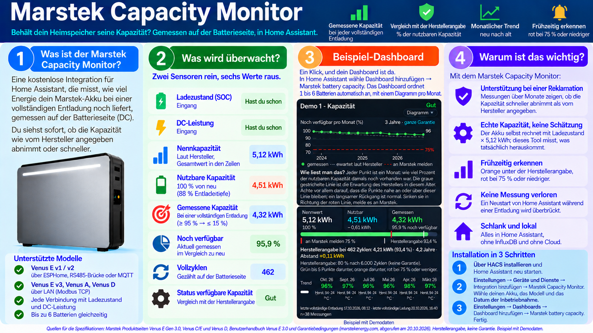
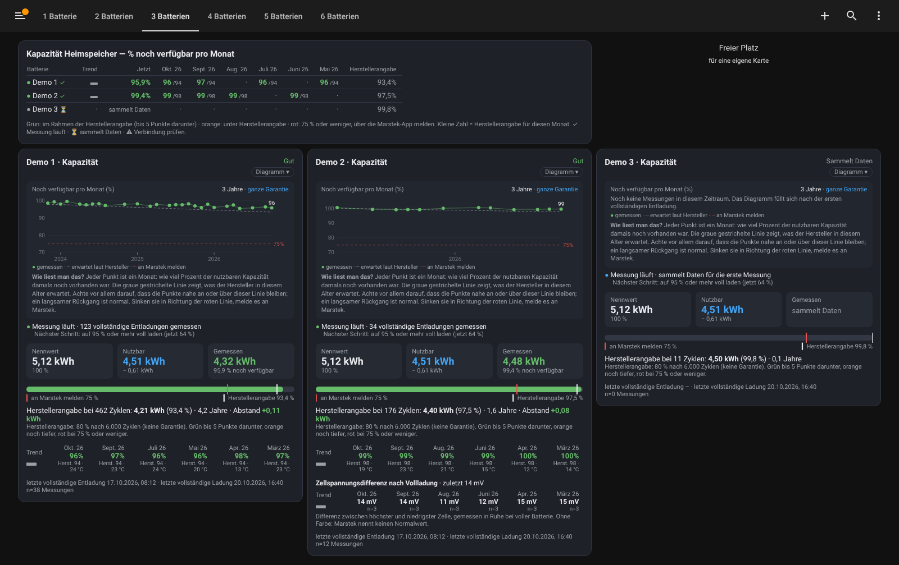

# Marstek Capacity Monitor

*[English](README.md) · [Nederlands](README.nl.md)*

Behalte in Home Assistant im Blick, ob dein Marstek-Heimspeicher seine Kapazität hält, gemessen auf der **DC-Seite** (an der Batterie selbst, nicht an der Steckdose). Bis zu **6 Batterien**.

> **Hält meine Batterie ihre Kapazität, verglichen mit der Herstellerangabe?**

## Kurz gesagt

- **Zwei Sensoren, die du schon hast:** Ladezustand und DC-Leistung der Batterie. Die Integration findet sie selbst.
- **Gemessen bei einer vollständigen Entladung** (≥ 95 % → ≤ 15 %) und verglichen mit der nutzbaren Kapazität im Neuzustand.
- **Herstellerangabe** als Maßstab: 80 % nach 6000 Zyklen. Grün im Rahmen der Herstellerangabe, orange darunter, rot bei 75 % oder weniger: über die Marstek-App melden.
- **Jede Anbindung, die Ladezustand und DC-Leistung liefert:** ESPHome, Modbus (RS485 oder LAN) oder eine andere Integration. Venus E v1, v2, v3, Venus A, Venus D.
- **Plug & Play:** Modell und Datum der Inbetriebnahme wählen; die Herstellerdaten werden für dich ausgefüllt.
- **Eigene Karten und ein Dashboard mit einem Klick:** kein button-card nötig.
- **Zeigt, ob es funktioniert:** ein Status pro Batterie und „sammelt Daten“ bis zur ersten vollständigen Entladung. Gab es in den letzten Tagen schon eine, gibt es sofort eine erste Messung.
- **Optional:** Zellspannungsdifferenz nach Vollladung und Zelltemperatur als Kontext (experimentell).
- **Diagramm** auf der Batteriekarte (letzte 3 Jahre oder die gesamte Garantiezeit von 10 Jahren): ein Klick auf „Diagramm“.
- **Schlank und lokal:** alles in Home Assistant, ohne InfluxDB und ohne Cloud.

## Installation in 3 Schritten

1. In HACS: drei Punkte → *Benutzerdefinierte Repositories* → URL dieses Repos, Typ *Integration*. **Marstek Capacity Monitor** herunterladen und Home Assistant neu starten.
2. **Einstellungen → Geräte & Dienste → Integration hinzufügen → Marstek Capacity Monitor**.
3. Die gefundene Batterie wählen, das Modell auswählen und das Datum der Inbetriebnahme eingeben. Fertig.

Starte Home Assistant danach neu und gehe zu **Einstellungen → Dashboards → Dashboard hinzufügen → Marstek battery capacity** (Home Assistant 2026.5 und neuer; ältere Versionen: siehe Anleitung). Das Dashboard ordnet deine Batterien (1 bis 6) von selbst an. Die Karten gehören zur Integration; button-card ist nicht mehr nötig. Ausführliche Anleitung: [docs/01-installation.de.md](docs/01-installation.de.md).

## Dokumentation

| Dokument | Inhalt |
|---|---|
| [01 – Installation](docs/01-installation.de.md) | Was du brauchst, HACS, Batterie hinzufügen, Karten |
| [06 – Dashboard und Galerie](docs/06-dashboard-gallery.de.md) | Aufteilung für 1 bis 6 Batterien, die Karte mit Nummern erklärt, Galerie |
| [02 – Configuration](docs/02-configuration.md) (Englisch) | Einstellungen, Sensoren, Messungen löschen |
| [03 – How it works](docs/03-how-it-works.md) (Englisch) | Drei Kapazitäten, Messung, Umrechnung auf 100 %, Herstellerangabe und Farben |
| [04 – Troubleshooting](docs/04-troubleshooting.md) (Englisch) | Häufige Meldungen und was zu tun ist |
| [05 – Supported batteries](docs/05-supported-batteries.md) (Englisch) | Modelle, Entladetiefe pro Modell, **Quellen der Herstellerangaben** |

Änderungen pro Version: [CHANGELOG](CHANGELOG.md) (Englisch).

## Screenshots

Die Screenshots verwenden **Demodaten**: erfundene Batterien, die zeigen, wie die Karten aussehen, nicht wie eine echte Batterie altert. Mehr Beispiele, von 1 bis 6 Batterien: [Galerie](docs/06-dashboard-gallery.de.md).

## Lizenz

[GPL-3.0](LICENSE)
