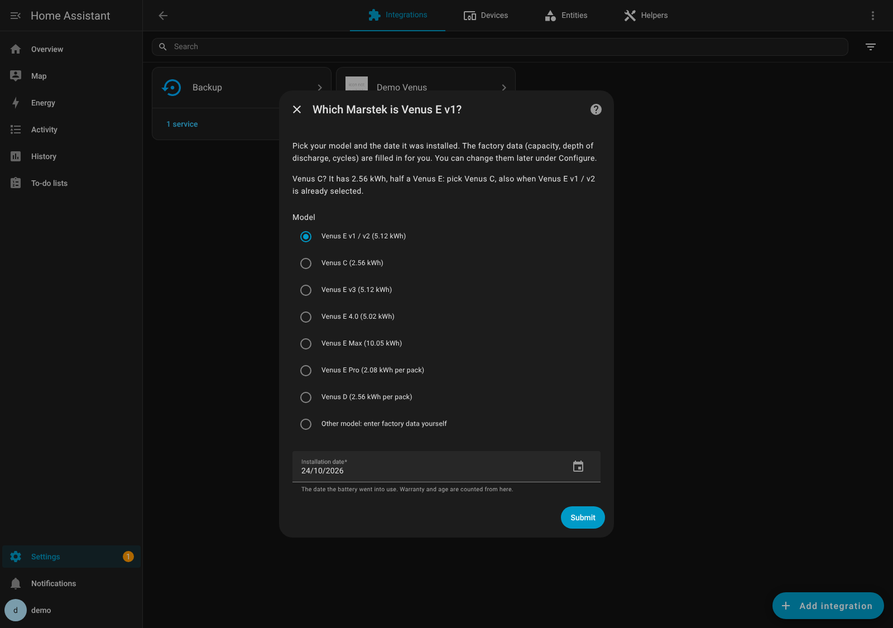
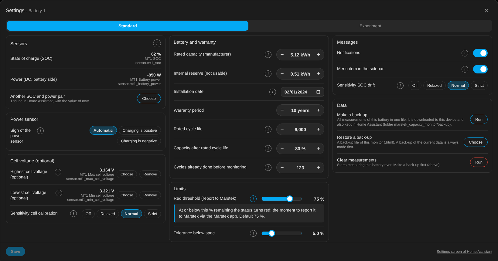

# Marstek Capacity Monitor

   

*[Nederlands](README.nl.md) · [Deutsch](README.de.md)*

Track in Home Assistant whether your Marstek home battery keeps its capacity, measured on the **DC side** (the battery itself, not the wall socket). Up to **6 batteries**.

> **Is my battery holding its capacity, compared to what the manufacturer specifies?**

 

## In short

- **Two sensors you already have:** state of charge and DC battery power. The integration finds them itself. 
- **Measured on a full discharge** (≥ 95 % → ≤ 15 %) and compared with the usable capacity of a new battery.
- **Manufacturer spec** as reference: 80 % after 6,000 cycles. Green within spec, orange below, red at 75 % or lower: report via the Marstek app.
- **Any connection that gives the state of charge and DC power:** ESPHome, Modbus (RS485 or LAN) or another integration. Venus E v1, v2, v3, 4.0, Max, Pro, Venus A, Venus C, Venus D.
- **Plug & play:** pick your model and installation date; the factory data are filled in for you. Cycles done before the monitor come from the battery's own counter when it has one (AC side, an estimate). Sensors found later show up under Repairs, ready to add.
- **Shows whether it works:** a status per battery, and "collecting data" until the first full discharge.
- **Optional cell balance check:** the spread between the highest and lowest cell after a full charge.
- **SOC drift and cell calibration** (new in 0.5): the monitor sees when the SOC meter drifts or the cells get out of balance, and only for a pattern gives a message with what to do. One click dismisses it.
- **Cell temperature as context (experimental)** and buttons **Chart · SOC · Cells · Report** on the battery card.
- **Settings on the card** (new in 1.0.0): the gear opens an own settings window with the tabs Standard and Experiment, an ⓘ with the explanation for every setting, sensors to choose with their value of now, and making or restoring a back-up.
- **Share your data, anonymously:** Report → Anonymous to share, then [Issues → Share data (anonymous)](https://github.com/satscan1/marstek-capacity-monitor/issues/new?template=share-data.yml). That way batteries can be compared.
- **Light and local:** everything inside Home Assistant, no InfluxDB or cloud.

## Install in 3 steps

1. In HACS, search for **Marstek Capacity Monitor**, download it and restart Home Assistant. (Not found? Three dots → *Custom repositories* → URL of this repo, type *Integration*.)
2. **Settings → Devices & services → Add integration → Marstek Capacity Monitor**.
3. Pick the battery that was found, choose its model and fill in the installation date. Done.

Then restart Home Assistant and go to **Settings → Dashboards → Add dashboard → Marstek battery capacity** (Home Assistant 2026.5+; older versions: see the guide). The dashboard arranges your batteries (1 to 6) by itself. The cards are part of the integration; button-card is no longer needed. Full instructions: [docs/01-installation.md](docs/01-installation.md).

## Documentation

| Document | Contents |
|---|---|
| [01 – Installation](docs/01-installation.md) | What you need, HACS, adding a battery, cards |
| [02 – Configuration](docs/02-configuration.md) | Settings, sensors, resetting measurements |
| [03 – How it works](docs/03-how-it-works.md) | Three capacities, measuring, conversion to 100 %, spec and colours |
| [04 – Troubleshooting](docs/04-troubleshooting.md) | Common messages and what to do |
| [05 – Supported batteries](docs/05-supported-batteries.md) | Models, depth of discharge per model, **sources for the manufacturer specs** |
| [06 – Dashboard and gallery](docs/06-dashboard-gallery.md) | Layout for 1 to 6 batteries, the card explained with numbers, gallery with and without chart |
| [07 – How the monitor measures](docs/07-measuring-method.md) | Why only full discharges count, and why measuring while the battery charges in between is not reliable |

Changes per version: [CHANGELOG](CHANGELOG.md).

## Screenshots

> The screenshots use **demo data**: five example batteries (Venus C, Venus E v1, v2, v3 and Venus D) with made-up measurements (about 2 % capacity loss per year). They show what the screens look like, not how these models actually age.

**1. Adding a battery: the scan finds the sensors you already have**

**2. Check the proposed sensors (cell voltage and cell temperature are optional)**

**3. Pick the model and the installation date: the factory data are filled in for you**

**4. Change everything later with the gear ⚙ on the card: an own settings window (from 1.0.0)**

**Or in the settings screen of Home Assistant (Configure): factory data and warranty…**

**…and further down the sign of the power sensor, notifications, the sidebar menu item and the sensitivity for SOC drift and cell calibration**

**5. One device per battery**

**6. The battery card (v0.5.1). More examples, from 1 to 6 batteries: [gallery](docs/06-dashboard-gallery.md)**

After a click on **Chart**: remaining capacity per month, against the manufacturer spec

After a click on **SOC**: is the SOC meter still right?

After a click on **Cells**: are the cells still in balance?

**7. Standard cards (no HACS needed)**

## Support this project

Find this tool useful? Give it a ⭐ on GitHub, so others can find it too.

Want to do a little more? Support me on [Ko-fi](https://ko-fi.com/satscan).

## License

[GPL-3.0](LICENSE)
