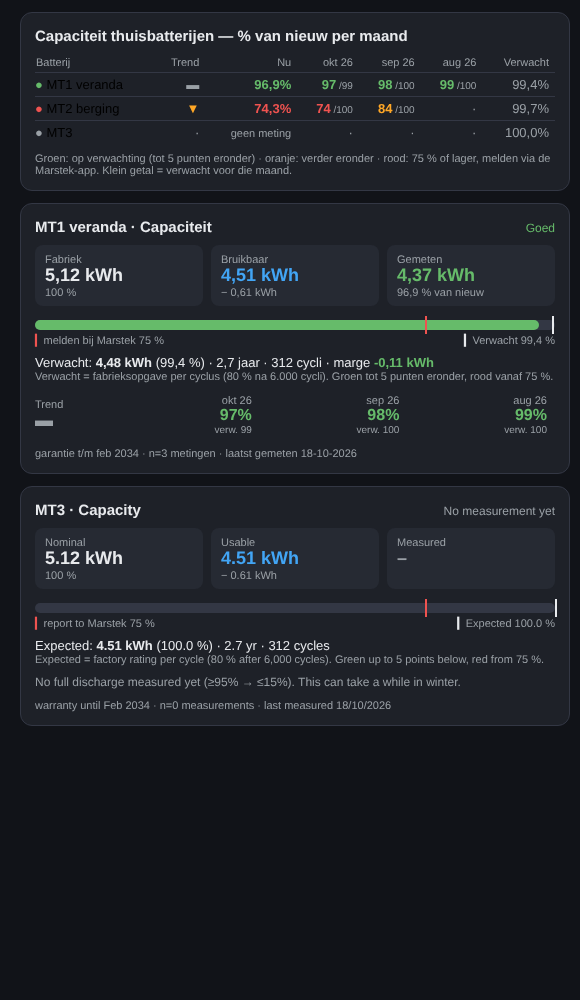

# Marstek Capacity Monitor

*[Nederlands](README.nl.md)*

Track in Home Assistant whether your home battery keeps its capacity. It measures on the **DC side**, meaning the battery itself, not the wall socket. Supports up to **6 batteries**.

## The question it answers

> **Is my battery holding its capacity, compared to what its use would predict?**

## What you need

Two sensors per battery, which you almost certainly already have:

* the **state of charge** (SOC, %);
* the **DC battery power** (W or kW), measured on the battery side, not the AC / grid side.

You do **not need to create any sensors**. When you add a battery, the integration scans Home Assistant and proposes the matching sensors for each battery.

| Marstek | Usually connected via | State of charge | DC power |
|---|---|---|---|
| Venus E v1 / v2 | RS485, through ESPHome (LilyGo, M5Stack) or an RS485 network bridge (Elfin EW11) with a Modbus integration | register 32104 | register 32102 |
| Venus E v3, Venus A, Venus D | Built-in LAN port with Modbus TCP | register 34002 | register 30001 |

**Any Marstek model with Modbus works**, over RS485 or LAN, as long as a Home Assistant integration provides the state of charge and the DC power as sensors. The table lists the verified models; only the registers differ, the data is the same. For another model, enter its own factory data when adding it (capacity, depth of discharge, cycles); the defaults are those of the Venus E 5.12 kWh.

 Integrations such as [marstek_venus_modbus](https://github.com/ViperRNMC/marstek_venus_modbus) and [Omnibattery](https://github.com/ffunes/Omnibattery), as well as the common ESPHome configs, provide both sensors.

**Not supported:** connections that only provide AC power, which includes most cloud connections. AC values include conversion losses and would give a wrong capacity. If you pick a sensor that looks like AC, you get a warning.

**You don't have to set plus or minus.** Some integrations report charging as positive, others as negative. On the first full charge or discharge the monitor detects this and reverses the sign if needed. You are notified when that happens. You can also set the sign manually.

## Three capacities, kept strictly apart

| | Meaning | Venus E 5.12 kWh |
|---|---|---|
| **Nominal capacity** | Total capacity of the cells, as rated by the factory | 5.12 kWh |
| **Usable capacity** | Nominal capacity × depth of discharge (DoD). This is **100 % of new**. | 90 % DoD → 4.61 kWh |
| **Measured capacity** | What actually came out of the cells during a **full discharge**, scaled to the usable band | e.g. 4.46 kWh = 97 % |

## How it measures

1. **Event**: every change of state of charge or DC power.
2. **Context**: the monitor integrates DC power into energy (like a Riemann helper, max. 1 minute per step) and detects charge and discharge swings. A swing closes once the state of charge moves back 3 points from its extreme. Only swings of 20 points or more are recorded.
3. **Result**: one record per swing, stored in Home Assistant itself (`.storage`). No InfluxDB needed.

Only **full discharges** count towards capacity: they must start at 95 % or higher and end at 15 % or lower. The calculation:

```
measured kWh = DC energy out of the cells ÷ drop in state of charge × usable band
```

The usable band is 90 points at 90 % DoD. The value shown is the **median of the last 3** full discharges in the past year.

Partial discharges are deliberately ignored, because one percent near the bottom delivers more kWh than one near the top. If the power data has a gap of more than 5 minutes during a swing, for example after a restart, that swing does not count.

## Expectation and colours

The expectation follows the **factory cycle rating**: 80 % capacity after 6,000 full cycles, which is 0.0033 points per cycle. Full cycles = DC discharged kWh ÷ usable capacity, plus any cycles done before monitoring started.

Marstek gives **no capacity guarantee in years**, so there is no time line.

| Colour | Meaning |
|---|---|
| 🟢 Green | On expected, or at most 5 points below |
| 🟠 Orange | Further below expected, but above 75 % |
| 🔴 Red | **75 % or lower**: report it to Marstek **via the Marstek app** |

The margin shows how many kWh the battery is above or below the expectation. All thresholds can be adjusted.

### Where the numbers come from

* **5,120 Wh, more than 6,000 cycles (at 25 °C), 90 % DoD**: Venus E datasheet.
* **80 % capacity retention after 6,000 cycles**: [Marstek Venus E Gen 3.0 product page](https://marstekenergy.com/en-us/products/marstek-venus-e-gen-3). The Dutch version of that page says 10,000 cycles.
* **10-year warranty**: Marstek product pages. The [warranty policy](https://marstekenergy.com/en-us/pages/warranty) covers material and manufacturing defects and states no capacity percentage.

Check your own terms. You can change them under **Settings → Devices & services → Marstek Capacity Monitor → Configure**.

## Installation

**Via HACS (custom repository)**

1. In HACS, open the three dots → *Custom repositories*. Enter the URL of this repo, type *Integration*.
2. Install **Marstek Capacity Monitor** and restart Home Assistant.

**Manually**

Copy `custom_components/marstek_capacity_monitor` to `/config/custom_components/` and restart.

**Adding a battery**

Go to **Settings → Devices & services → Add integration → Marstek Capacity Monitor**.

1. Pick a battery that was found, or choose the sensors yourself.
2. Check the short id (`mt1` … `mt6`), the name and the two sensors.
3. Enter the factory data: nominal capacity, reserve, purchase date, warranty period and cycles. The defaults come from the Venus E datasheet.

## Sensors (per battery, example `mt1`)

| Entity | What |
|---|---|
| `sensor.marstek_mt1_measured_capacity` | Measured capacity (kWh). Attributes: `trend` (per month, newest → oldest) and `history` (last 10 full discharges) |
| `sensor.marstek_mt1_capacity_pct` | Measured capacity as % of new |
| `sensor.marstek_mt1_expected_capacity` | Expected capacity (%) from the cycle line |
| `sensor.marstek_mt1_margin` | Margin vs expected (kWh) |
| `sensor.marstek_mt1_cycles` | Number of full cycles |
| `sensor.marstek_mt1_warranty_status` | `good` / `attention` / `critical` / `no_measurement` |
| `sensor.marstek_mt1_nominal_capacity` · `_usable_capacity` · `_red_threshold` · `_warranty_end` · `_dc_discharged` | Diagnostics. `_dc_discharged` also shows which sensors are used and how the sign was detected |

After every recorded swing, the integration fires the event `marstek_capacity_monitor_session`. You can use it to forward the records yourself, for example to InfluxDB.

Write load stays low:

* the `trend` and `history` lists are not written to the recorder database;
* the sensors only change after a measurement or once per hour.

## Cards

| Folder | Requires | Content |
|---|---|---|
| `cards/button-card/` | [button-card](https://github.com/custom-cards/button-card) (HACS) | Overview of up to 6 batteries: per month, trend column first, newest → oldest. Plus a detail card per battery. Set the language with `lang: en` or `nl`. |
| `cards/standard/` | nothing | Entities card and statistics graph (measured vs expected per month) |



## Resetting measurements

Use the action `marstek_capacity_monitor.reset_measurements` with the battery as target. This cannot be undone.

If you remove a battery from the integration, its measurements stay in `.storage/`. They may be needed as evidence when you report a problem to Marstek.

## Tests

```
pip install pytest-homeassistant-custom-component
pytest
```
