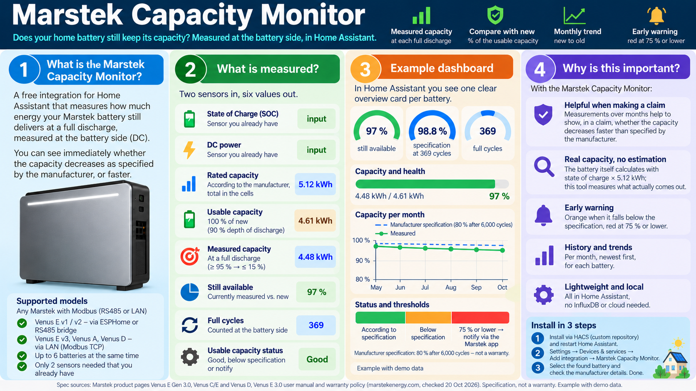
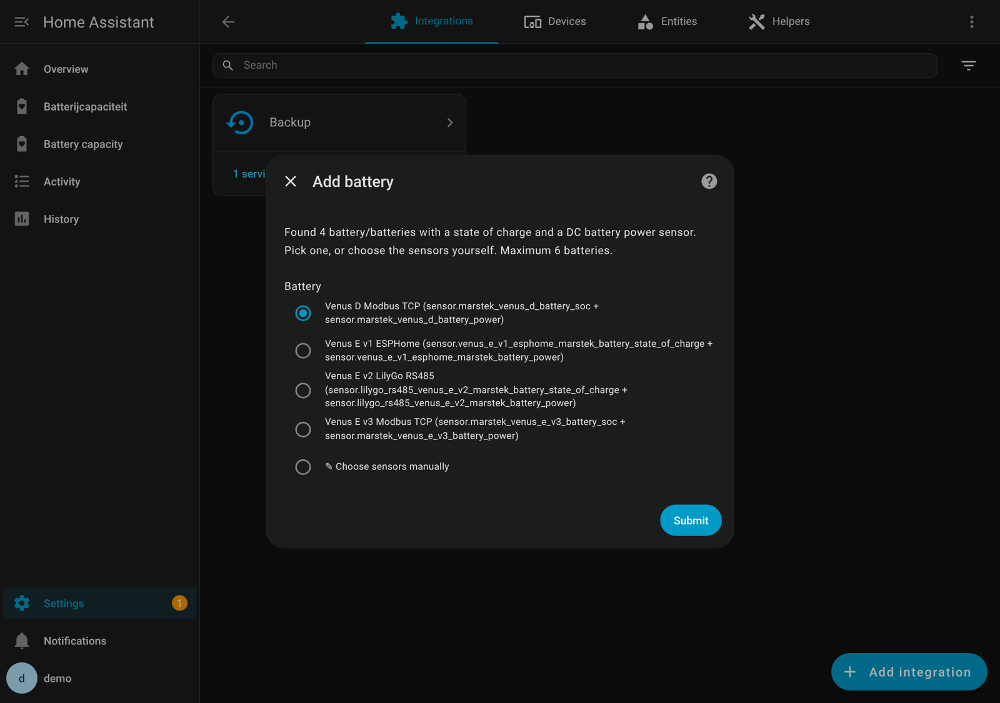
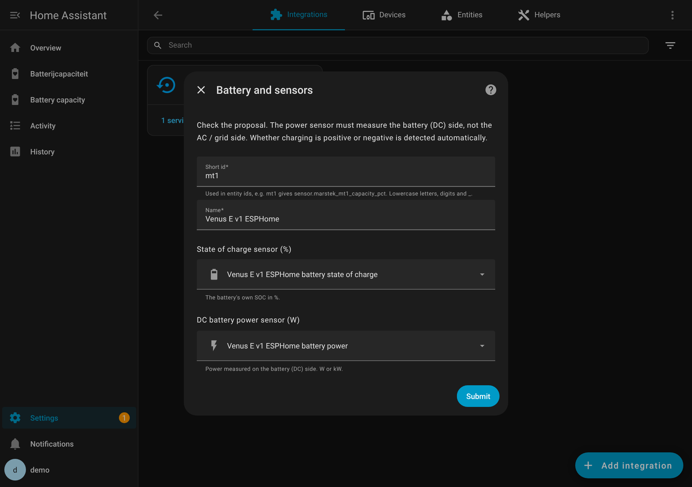
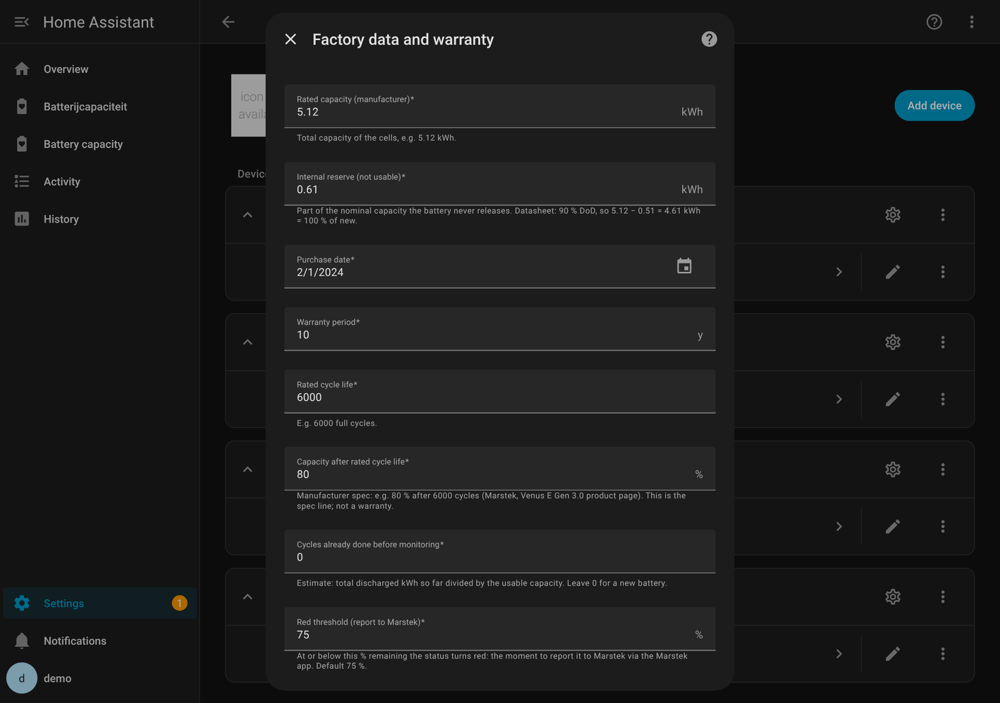
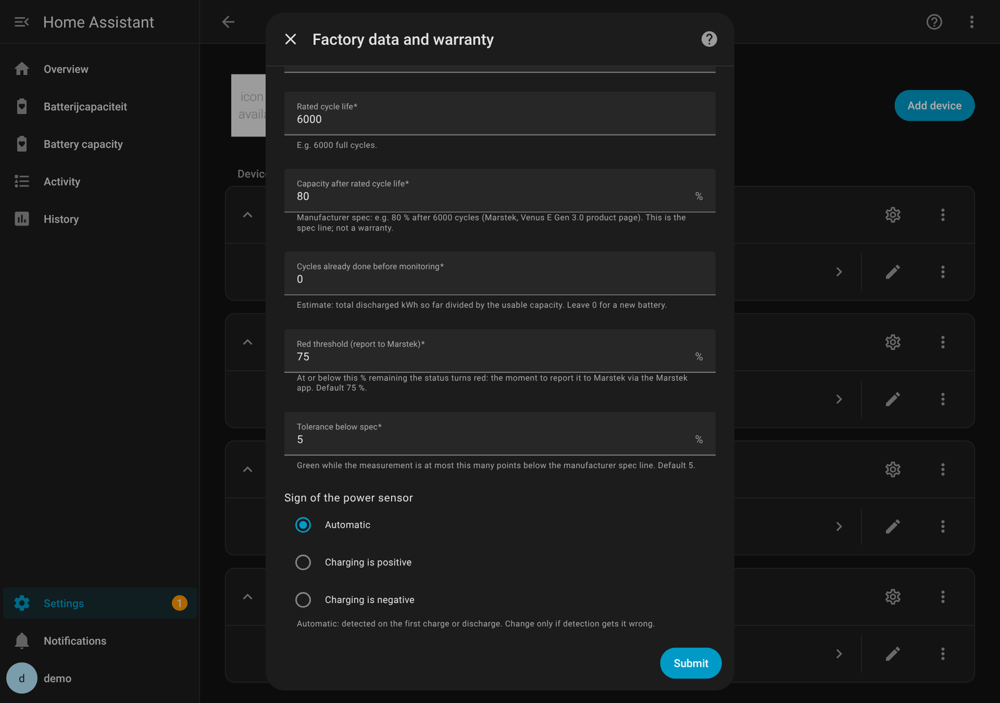
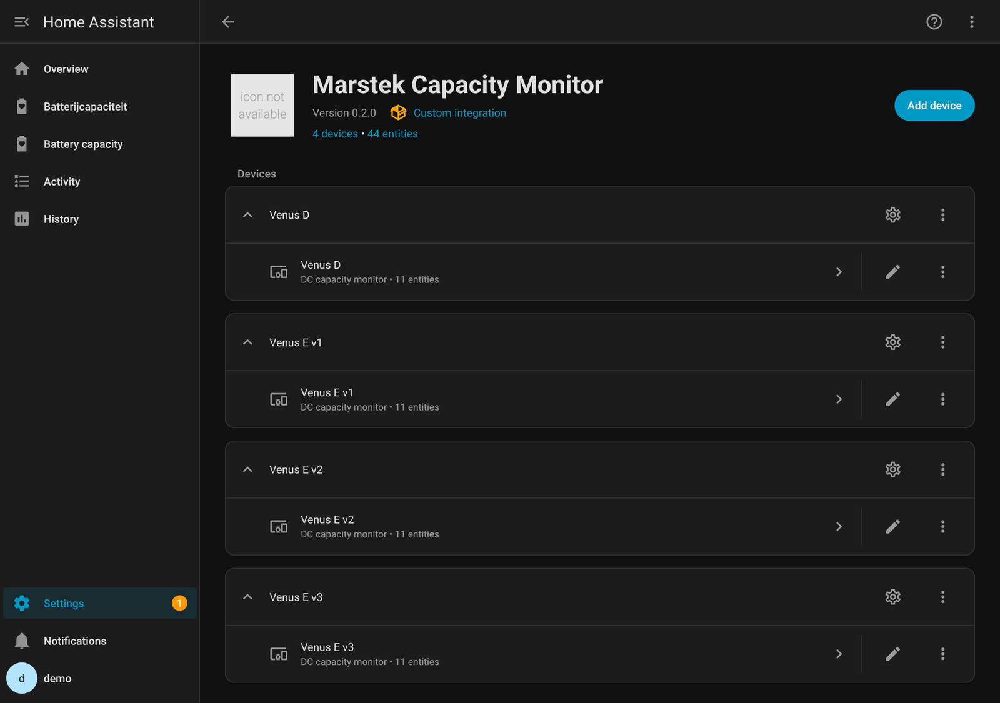
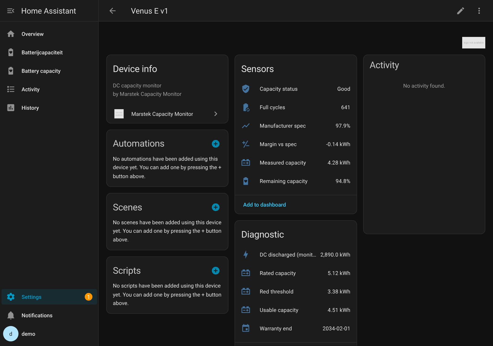
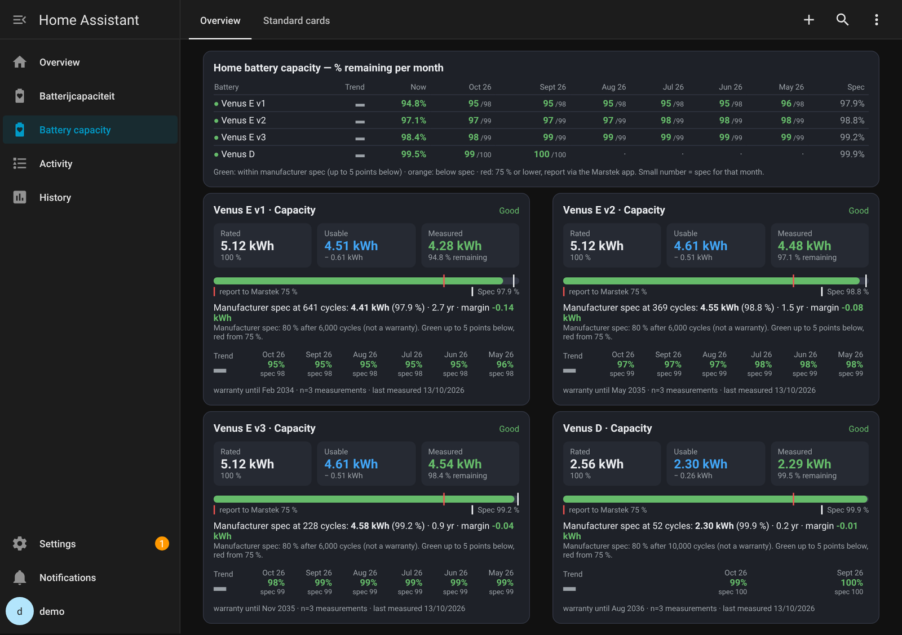
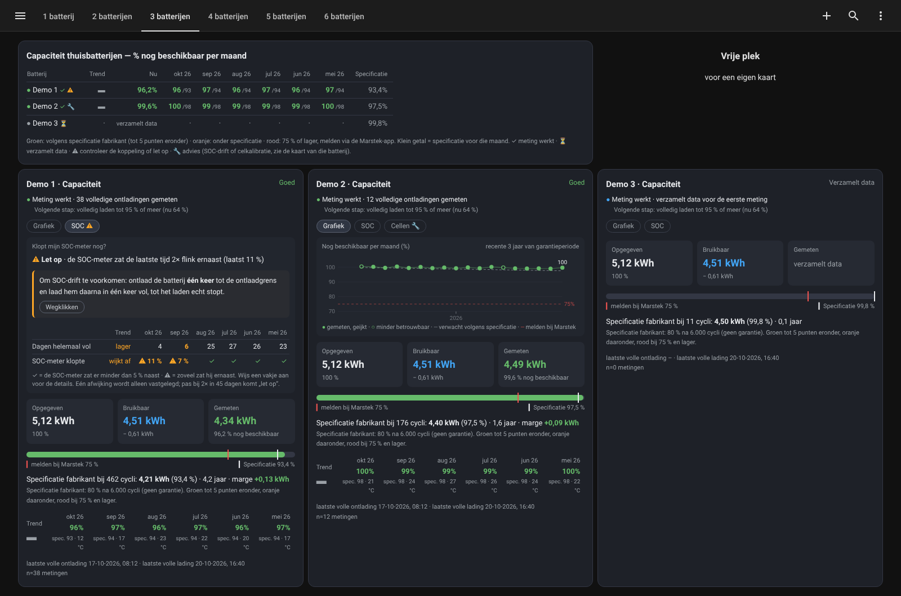
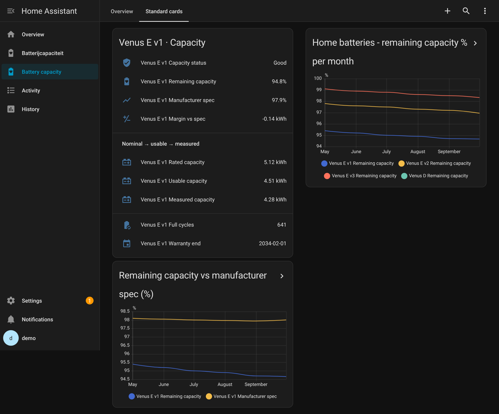

# Marstek Capacity Monitor

*[Nederlands](README.nl.md)*

Track in Home Assistant whether your Marstek home battery keeps its capacity, measured on the **DC side** (the battery itself, not the wall socket). Up to **6 batteries**.

> **Is my battery holding its capacity, compared to what the manufacturer specifies?**

## In short

- **Two sensors you already have:** state of charge and DC battery power. The integration finds them itself.
- **Measured on a full discharge** (≥ 95 % → ≤ 15 %) and compared with the usable capacity of a new battery.
- **Manufacturer spec** as reference: 80 % after 6,000 cycles. Green within spec, orange below, red at 75 % or lower: report via the Marstek app.
- **Any Marstek with Modbus** (RS485 or LAN): Venus E v1, v2, v3, Venus A, Venus D.
- **Light and local:** everything inside Home Assistant, no InfluxDB or cloud.

## Install in 3 steps

1. In HACS: three dots → *Custom repositories* → URL of this repo, type *Integration*. Install **Marstek Capacity Monitor** and restart Home Assistant.
2. **Settings → Devices & services → Add integration → Marstek Capacity Monitor**.
3. Pick the battery that was found and check the factory data. Done.

Then add the cards from [`dashboard/`](dashboard/). Full instructions: [docs/01-installation.md](docs/01-installation.md).

## Documentation

| Document | Contents |
|---|---|
| [01 – Installation](docs/01-installation.md) | What you need, HACS, adding a battery, cards |
| [02 – Configuration](docs/02-configuration.md) | Settings, sensors, resetting measurements |
| [03 – How it works](docs/03-how-it-works.md) | Three capacities, measuring, conversion to 100 %, spec and colours |
| [04 – Troubleshooting](docs/04-troubleshooting.md) | Common messages and what to do |
| [05 – Supported batteries](docs/05-supported-batteries.md) | Models, depth of discharge per model, **sources for the manufacturer specs** |

Changes per version: [CHANGELOG](CHANGELOG.md).

## Screenshots

> The screenshots use **demo data**: four example batteries (Venus E v1 via ESPHome, Venus E v2 via LilyGo RS485, Venus E v3 and Venus D via Modbus TCP) with made-up measurements (about 2 % capacity loss per year). They show what the screens look like, not how these models actually age.

**1. Adding a battery: the scan finds the sensors you already have**

**2. Check the proposed sensors**

**3. Factory data (defaults from the Venus E datasheet; this view is the settings screen with an existing battery)**

**4. Change settings later, including the sign of the power sensor**

**5. One device per battery**

**6. button-card: overview and detail cards (English and Dutch)**

**7. Standard cards (no HACS needed)**

## License

[GPL-3.0](LICENSE)
