# 06 – Dashboard: Aufteilung, Karte und Galerie

*[English](06-dashboard-gallery.md) · [Nederlands](06-dashboard-gallery.nl.md)*

Auf dieser Seite siehst du, wie die Karten bei 1 bis 6 Batterien aussehen, was jeder Teil der Batteriekarte bedeutet und wie du die Karten anordnest.

> Alle Bilder auf dieser Seite verwenden **Demodaten**: sechs erfundene Batterien mit unterschiedlichem Alter und Zustand. Sie zeigen, wie die Karten aussehen, nicht wie eine echte Batterie altert. Die Karten erscheinen auf Deutsch, wenn Home Assistant auf Deutsch eingestellt ist.

## Aufteilung

Die Batteriekarte ist für **ein Drittel der Breite** gemacht: drei Batterien nebeneinander.

| Anzahl Batterien | Aufteilung |
|---|---|
| 1 oder 2 | Die Batterien, rechts daneben die Übersicht (eine Reihe mit drei Karten) |
| 3 | Übersicht zwei Drittel breit, darunter 3 Batterien |
| 4 | Übersicht zwei Drittel breit, darunter 2 × 2 |
| 5 | Übersicht zwei Drittel breit, darunter 3 + 2 |
| 6 | Übersicht zwei Drittel breit, darunter 3 + 3 |

Ab 3 Batterien ist neben der Übersicht ein Drittel frei für eine eigene Karte. Lässt du den Platz leer, schiebt Home Assistant die erste Batterie nach oben neben die Übersicht; sollen die Batterien in einer neuen Reihe beginnen, setze dort eine Karte hin (das Dashboard mit einem Klick und die fertigen Dashboards verwenden eine Textkarte „Freier Platz“).

Das [Dashboard mit einem Klick](01-installation.de.md#am-schnellsten-dashboard-mit-einem-klick) verwendet diese Aufteilung von selbst. Für button-card gibt es [fertige Dashboards](01-installation.de.md#fertiges-dashboard-mit-button-card), eines für jede Batterieanzahl.

Selbst anordnen? Verwende den Ansichtstyp **Abschnitte** (Sections) von Home Assistant. Ein Beispiel steht in [`dashboard/button-card/layout-sections.yaml`](../dashboard/button-card/layout-sections.yaml). Jede Karte bekommt ihre Breite über `grid_options`: in einem Abschnitt mit drei Spalten ist `columns: 12` ein Drittel und `columns: 24` zwei Drittel. Bei 4 Batterien nimm `columns: 18` pro Batterie.

## Die Batteriekarte

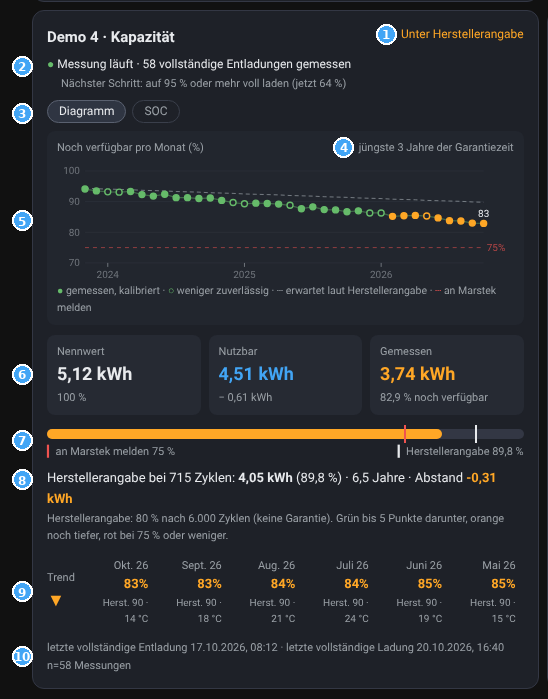

1. **Status**: *Gut*, *Unter Herstellerangabe*, *An Marstek melden (App)* oder *Sammelt Daten*. Die Farbe folgt der letzten Messung.
2. **Läuft die Messung?** Grün: Die Messung läuft, mit der Zahl der gemessenen vollständigen Entladungen. Blau: sammelt noch Daten. Orange oder rot: keine neuen Daten oder ein Sensor fehlt. Beim Sammeln oder während einer vollständigen Entladung steht der nächste Schritt darunter; sonst siehst du ihn beim Zeigen auf die Zeile.
3. **Diagramm · SOC · Zellen**: *Diagramm* zeigt das Diagramm an der Stelle der Kapazitäten (noch einmal drücken = zurück); die Karte bleibt gleich hoch. *SOC* und *Zellen* öffnen ein Fenster in der Mitte des Bildschirms; ✕ oder ein Klick daneben schließt es. Ein ⚠ (Achtung) oder 🔧 (Empfehlung) auf *SOC* oder *Zellen* heißt: kurz hineinschauen. *Zellen* erscheint nur, wenn die Zellspannungen eingetragen sind.
4. **Einstellungen** (Zahnrad): öffnet das Einstellungsfenster dieser Batterie, mit den Tabs Standard und Experiment (ab 1.0.0). Siehe [Konfiguration](02-configuration.md).
5. **Drei Kapazitäten**: *Nennwert* (auf dem Typenschild), *Nutzbar* (Nennwert abzüglich der Reserve, die die Batterie selbst behält) und *Gemessen* (was jetzt wirklich herauskommt, und wie viel Prozent der nutzbaren Kapazität das sind).
6. **Balken**: die gemessene Kapazität, mit einem weißen Strich für die Herstellerangabe und einem roten Strich bei 75 %.
7. **Abstand**: wie weit du über (+) oder unter (−) der Herstellerangabe liegst, mit Zyklen und Alter. Zeige darauf für die Herstellerangabe in kWh und woher die Zyklen vor der Überwachung kommen.
8. **Letzte vollständige Entladung und Ladung** und die Version der Karte.

**Das Diagramm** zeigt die jüngsten 3 Jahre. Jeder Punkt ist ein Monat: wie viel der nutzbaren Kapazität damals noch vorhanden war. ● gemessen, kalibriert · ○ weniger zuverlässig (in den 14 Tagen davor nicht ganz voll, oder Zellen kälter als 5 °C) · graue gestrichelte Linie: erwartet laut Herstellerangabe · rote gestrichelte Linie: an Marstek melden (75 %). Zeige auf einen Punkt für Wert, Herstellerangabe und Zelltemperatur in diesem Monat.

**SOC und Zellen** beantworten *Stimmt meine SOC-Anzeige noch?* (pro Monat *Tage ganz voll* und *SOC-Anzeige stimmte*) und *Sind meine Zellen noch im Gleichgewicht?* (Zellspannungsdifferenz pro Monat). Bei Achtung oder Empfehlung steht im Fenster, was zu tun ist, und eine Schaltfläche **Ausblenden**.

Hast du Sensoren für die höchste und niedrigste Zellspannung verknüpft, steht die **Zellspannungsdifferenz nach Vollladung** im Feld **Zellen** (bis 0.4 unter dem Trend).

## Die Übersicht

Die Übersicht zeigt alle Batterien (bis 6) untereinander:

- **Batterie**: mit ✓ (Messung läuft), ⏳ (sammelt Daten) oder ⚠ (Verbindung prüfen). Ab 0.5 auch ⚠ (Achtung) oder 🔧 (Empfehlung) für SOC-Drift oder Zellkalibrierung; zeige darauf, um zu sehen, welche, und öffne die Karte dieser Batterie.
- **Trend**: ▲ steigend, ▬ stabil, ▼ fallend über die gezeigten Monate.
- **Jetzt**: die letzte Messung.
- **Monate**, von neu nach alt: große Zahl = gemessen, kleine Zahl = Herstellerangabe für diesen Monat.
- **Herstellerangabe**: was der Hersteller jetzt erwartet.

Grün: höchstens 5 Punkte unter der Herstellerangabe. Orange: darunter. Rot: 75 % oder weniger, über die Marstek-App melden.

## Galerie

Jede der sechs Demobatterien zeigt eine andere Situation:

| Batterie | Situation |
|---|---|
| Demo 1 | 4 Jahre alt, gut; steht draußen, daher offene Punkte im Winter; SOC-Anzeige 2× deutlich daneben: ⚠ Achtung bei SOC |
| Demo 2 | 1,6 Jahre alt, gut, mit Zellspannungsdifferenz: 🔧 Zellkalibrierung empfohlen |
| Demo 3 | Gerade in Betrieb genommen: sammelt Daten für die erste Messung |
| Demo 4 | 6,5 Jahre alt, unter Herstellerangabe (orange) |
| Demo 5 | 9 Jahre alt, knapp unter 75 %: an Marstek melden (rot), Zellen im Gleichgewicht |
| Demo 6 | 2,8 Jahre alt, gut, aber seit einer Weile keine neuen Daten (⚠) |

### 1 Batterie

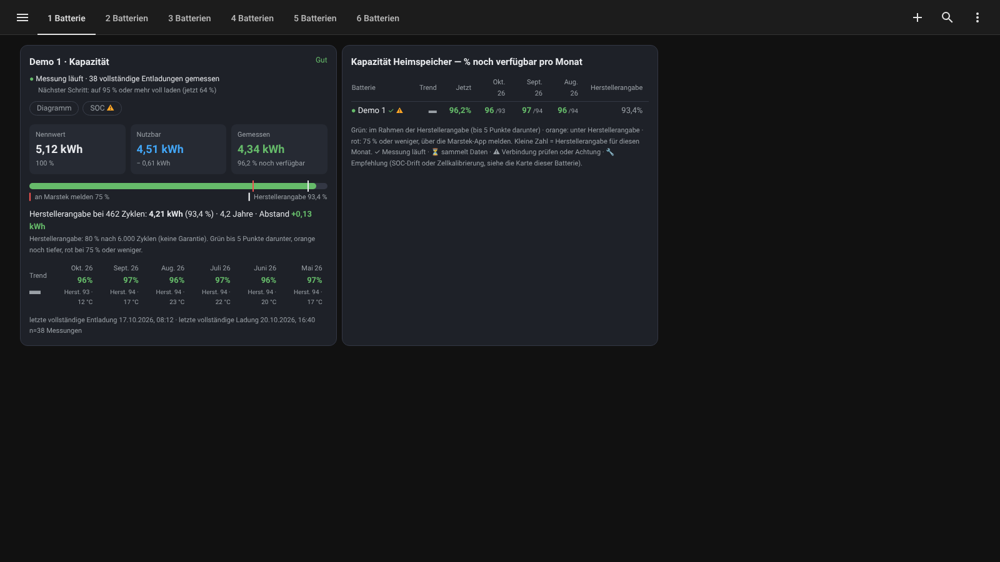
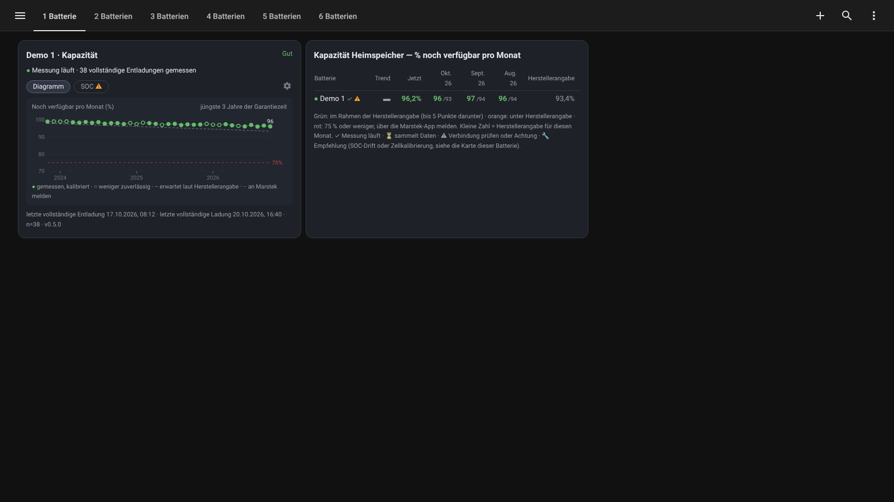

### 2 Batterien

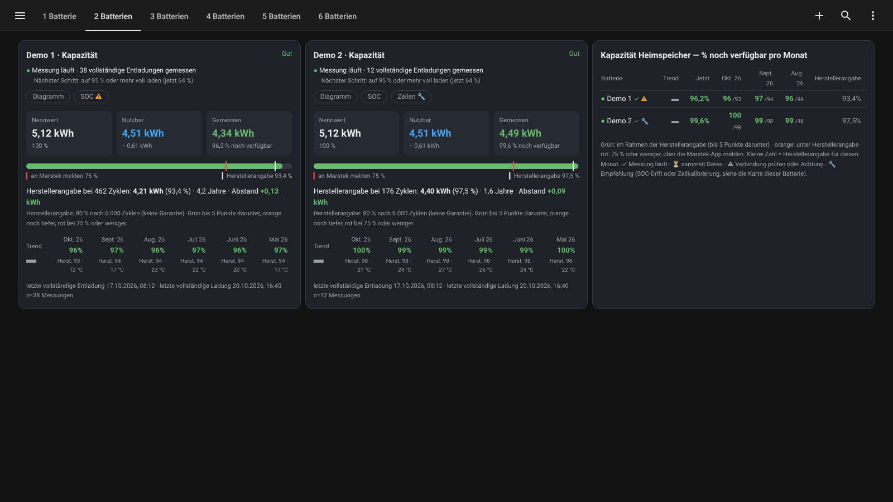
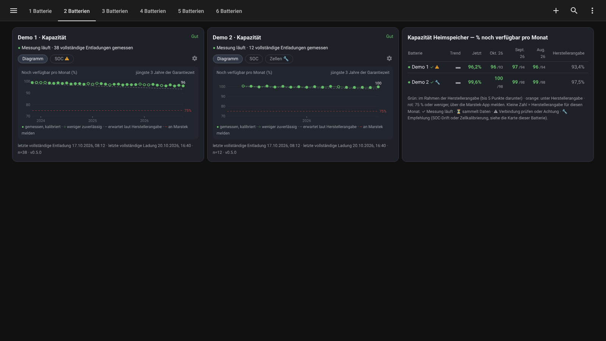

### 3 Batterien

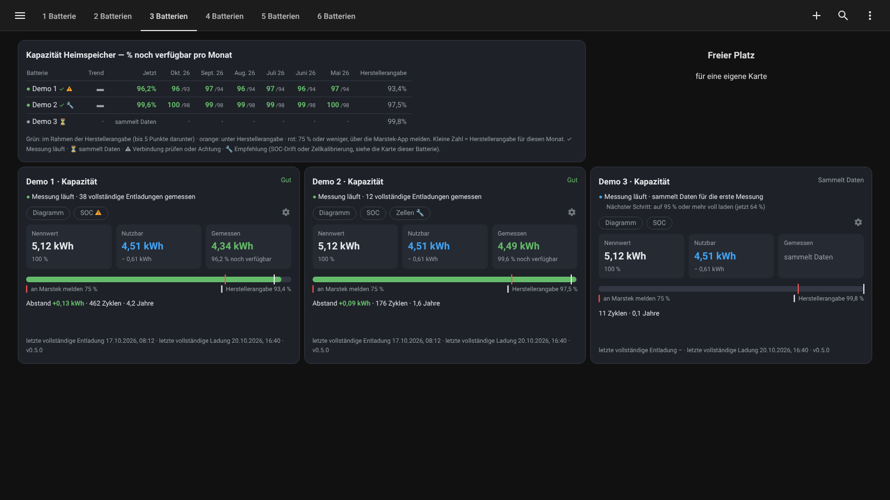

### 4 Batterien

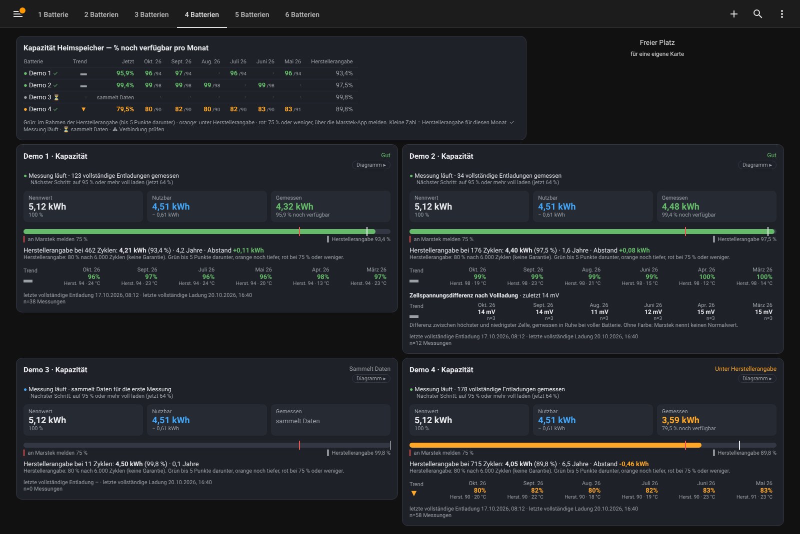
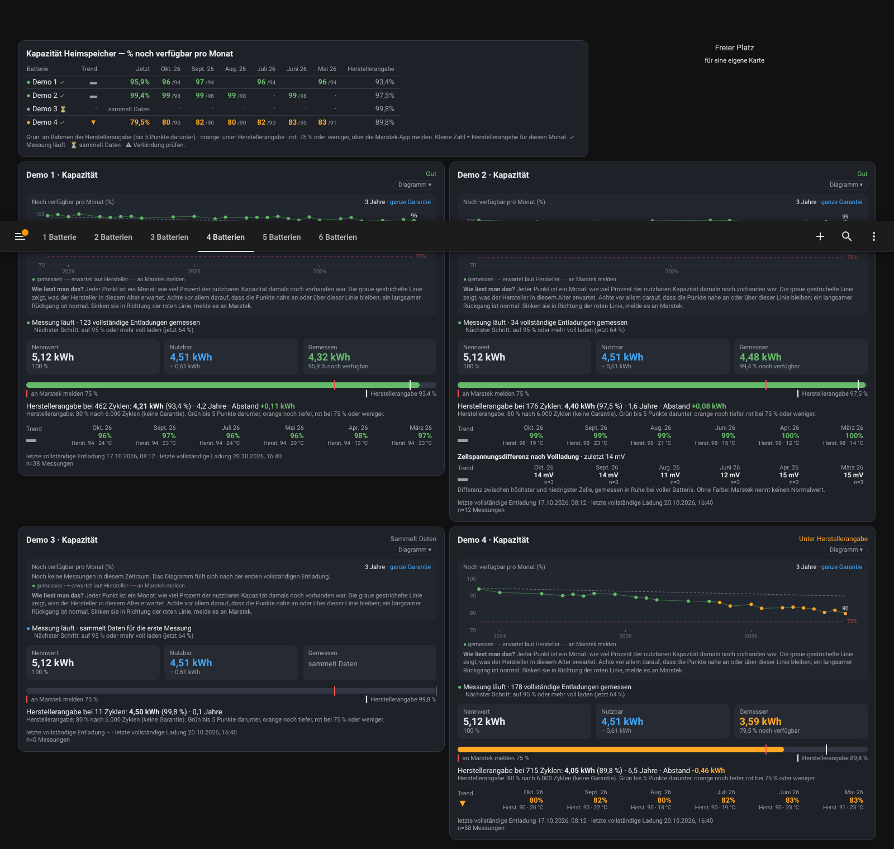

### 5 Batterien

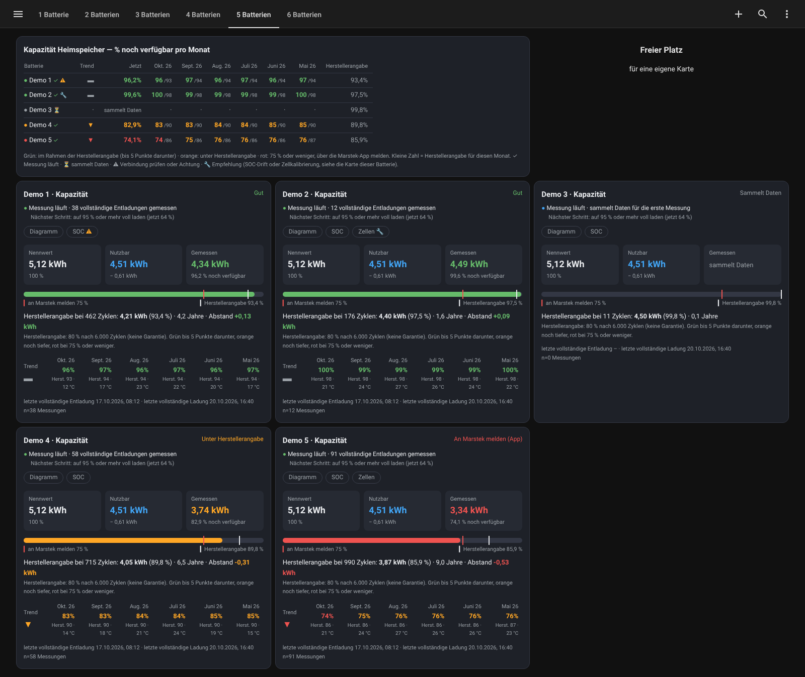
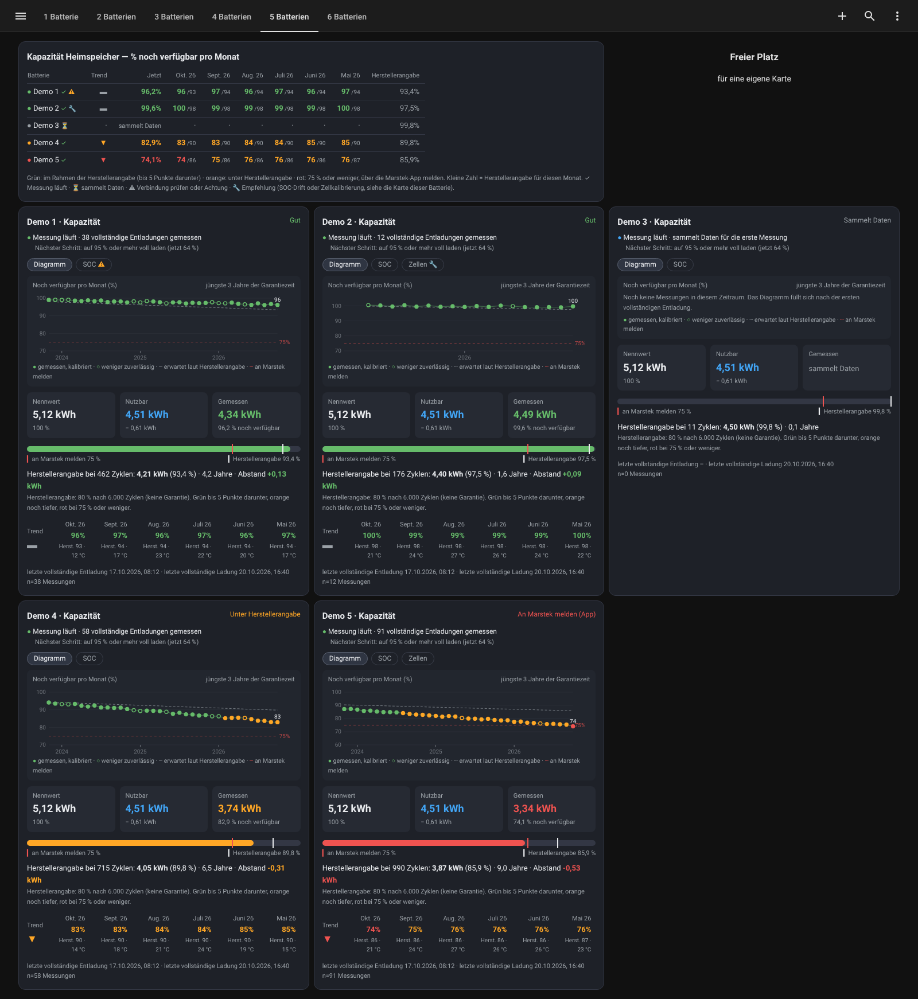

### 6 Batterien

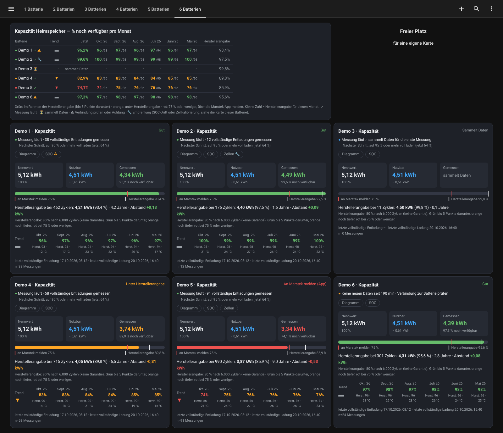
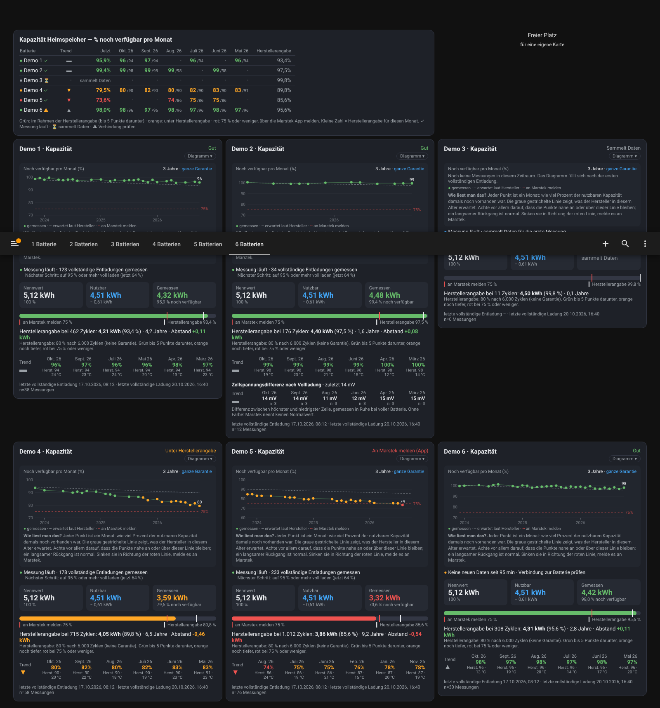

## Demo selbst ausprobieren

Die Karten akzeptieren über die Option `demo` erfundene Daten (bei button-card: die Variable `demo`); die Galerie oben wurde damit erstellt. Diese Daten stehen nur in der Dashboard-Konfiguration: Es werden keine Sensoren angelegt und nichts landet in deinem Verlauf. Für die normale Nutzung brauchst du das nicht.
