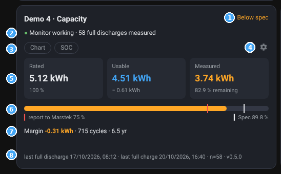
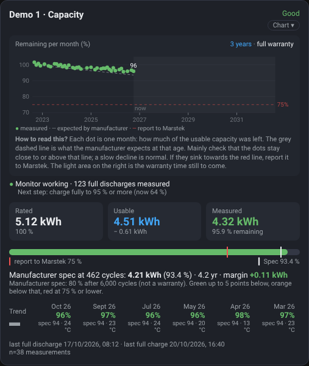

# 06 – Dashboard: layout, card and gallery

This page shows how the cards look with 1 to 6 batteries, what each part of the battery card means and how to arrange the cards.

> All images on this page use **demo data**: six made-up batteries of different ages and conditions. They show how the cards look, not how a real battery ages. The gallery screenshots are in Dutch; the numbered card below is shown in English.

## Layout

The battery card is made for **one third of the width**: three batteries side by side.

| Number of batteries | Layout |
|---|---|
| 1 or 2 | The batteries, with the overview to the right (one row of three) |
| 3 | Overview two thirds wide, then 3 batteries |
| 4 | Overview two thirds wide, then 2 × 2 |
| 5 | Overview two thirds wide, then 3 + 2 |
| 6 | Overview two thirds wide, then 3 + 3 |

From 3 batteries on, one third next to the overview is free for a card of your own. If you leave it empty, Home Assistant moves the first battery up next to the overview; to start the batteries on a new row, put a card there (the ready-made dashboards use a text card "Free spot").

This layout is ready in the [ready-made dashboards](01-installation.md#quickest-way-ready-made-dashboard), one per number of batteries.

Arranging it yourself? Use Home Assistant's standard **Sections** layout. An example is in [`dashboard/button-card/layout-sections.yaml`](../dashboard/button-card/layout-sections.yaml). Give each card a width with `grid_options`: in a section three columns wide, `columns: 12` is one third and `columns: 24` is two thirds. With 4 batteries use `columns: 18` per battery.

## The battery card

1. **Status**: *Good*, *Below spec*, *Report to Marstek (app)* or *Collecting data*. The colour follows the latest measurement.
2. **Chart**: press this small button to open the chart, press again to close it. The rest of the card does nothing when clicked.
3. **Period**: by default the last **3 years**. *Full warranty* shows the whole warranty period (up to 10 years); the light area on the right is the warranty time still to come.
4. **Chart**: each dot is one month, with the percentage of the usable capacity that was left. The grey dashed line is what the manufacturer expects at that age, the red line is 75 %. Hover over a dot for the exact value and the cell temperature that month (if you linked temperature sensors).
5. **How to read this?** A short explanation below the chart: check that the dots stay close to or above the grey line. A slow decline is normal; if they sink towards the red line, report it to Marstek.
6. **Is the monitor working?** Green: working, with the number of full discharges measured. Blue: still collecting data. Orange or red: no new data, or a sensor is missing. The line below tells the next step (for example *charge fully to 95 %*).
7. **Three capacities**: *Rated* (on the type plate), *Usable* (rated minus the reserve the battery keeps) and *Measured* (what really comes out now, and what percentage of usable that is).
8. **Bar**: the measured capacity, with a white mark for the manufacturer spec and a red mark at 75 %.
9. **Manufacturer spec** at the current cycle count and age, and the margin: how far above (+) or below (−) you are.
10. **Monthly trend**: first the direction (▲ ▬ ▼), then the months from new to old. Large number = measured, small number = spec for that month, plus the cell temperature if available.
11. **Last full discharge and full charge**, and the number of measurements.

If you linked sensors for the highest and lowest cell voltage, the **cell spread after full charge** appears below the trend (see Demo 2 in the gallery).

With *full warranty* the chart looks like this:

## The overview

The overview lists all batteries (up to 6):

- **Battery**: with ✓ (monitor working), ⏳ (collecting data) or ⚠ (check the connection).
- **Trend**: ▲ rising, ▬ stable, ▼ falling over the months shown.
- **Now**: the latest measurement.
- **Months**, new to old: large number = measured, small number = spec for that month.
- **Spec**: what the manufacturer expects now.

Green: within 5 points of the spec. Orange: below that. Red: 75 % or lower, report via the Marstek app.

## Gallery

Each of the six demo batteries shows a different situation:

| Battery | Situation |
|---|---|
| Demo 1 | 4 years old, good |
| Demo 2 | 1.6 years old, good, with cell spread |
| Demo 3 | Just installed: collecting data for the first measurement |
| Demo 4 | 6.5 years old, below spec (orange) |
| Demo 5 | 9 years old, just below 75 %: report to Marstek (red) |
| Demo 6 | 2.8 years old, good, but no new data for a while (⚠) |

### 1 battery

### 2 batteries

### 3 batteries

### 4 batteries

### 5 batteries

### 6 batteries

## Trying a demo yourself

The cards accept a `demo` variable with fake data; the gallery above was made with it. That data lives only in the dashboard configuration: no sensors are created and nothing goes into your history. You do not need this for normal use.
