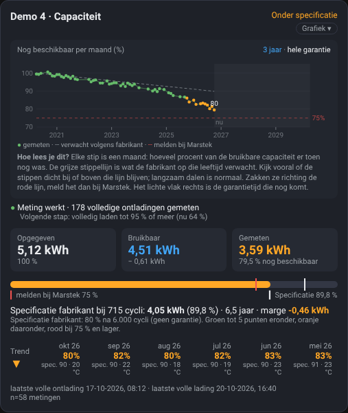

# 06 – Dashboard: indeling, kaart en galerij

Op deze pagina zie je hoe de kaarten eruitzien bij 1 tot 6 batterijen, wat elk onderdeel van de batterijkaart betekent en hoe je de kaarten neerzet.

> Alle afbeeldingen op deze pagina gebruiken **demogegevens**: zes verzonnen batterijen met verschillende leeftijden en toestanden. Ze laten zien hoe de kaarten eruitzien, niet hoe een echte batterij veroudert.

## Indeling

De batterijkaart is gemaakt voor **een derde van de breedte**: drie batterijen naast elkaar.

| Aantal batterijen | Indeling |
|---|---|
| 1 of 2 | De batterijen, met het overzicht rechts ernaast (één rij van drie) |
| 3 | Overzicht twee derde breed, daaronder 3 batterijen |
| 4 | Overzicht twee derde breed, daaronder 2 × 2 |
| 5 | Overzicht twee derde breed, daaronder 3 + 2 |
| 6 | Overzicht twee derde breed, daaronder 3 + 3 |

Naast het overzicht is vanaf 3 batterijen een derde vrij voor een eigen kaart. Zet je daar niets neer, dan schuift Home Assistant de eerste batterij omhoog naast het overzicht; wil je de batterijen op een nieuwe rij, zet er dan een kaart neer (in de galerij een tekstkaart "Vrije plek").

Gebruik hiervoor de standaardindeling van Home Assistant met **secties** ("Sections"). Een voorbeeld staat in [`dashboard/button-card/layout-sections.yaml`](../dashboard/button-card/layout-sections.yaml). Je geeft elke kaart een breedte met `grid_options`: in een sectie van drie kolommen is `columns: 12` een derde en `columns: 24` twee derde. Bij 4 batterijen gebruik je `columns: 18` per batterij.

## De batterijkaart

1. **Status**: *Goed*, *Onder specificatie*, *Melden bij Marstek (app)* of *Verzamelt data*. De kleur volgt de laatste meting.
2. **Grafiek**: druk op dit knopje om de grafiek te openen, druk nog eens om hem te sluiten. De rest van de kaart doet niets als je erop klikt.
3. **Periode**: standaard zie je de laatste **3 jaar**. Met *hele garantie* zie je de hele garantietijd (tot 10 jaar). Het lichte vlak rechts is de garantietijd die nog komt.
4. **Grafiek**: elke stip is een maand, met hoeveel procent van de bruikbare capaciteit er toen nog was. De grijze stippellijn is wat de fabrikant op die leeftijd verwacht, de rode lijn is 75 %. Ga met de muis over een stip voor het precieze getal en de celtemperatuur in die maand (als je temperatuursensoren hebt gekoppeld).
5. **Hoe lees je dit?** Korte uitleg onder de grafiek: kijk of de stippen dicht bij of boven de grijze lijn blijven. Langzaam dalen is normaal; zakken ze richting de rode lijn, meld het dan bij Marstek.
6. **Werkt de meting?** Groen: de meting werkt en zoveel volledige ontladingen zijn gemeten. Blauw: nog data aan het verzamelen. Oranje of rood: geen nieuwe gegevens of een sensor ontbreekt. De regel eronder zegt wat de volgende stap is (bijvoorbeeld *volledig laden tot 95 %*).
7. **Drie capaciteiten**: *Opgegeven* (op het typeplaatje), *Bruikbaar* (opgegeven min de reserve die de batterij zelf vasthoudt) en *Gemeten* (wat er nu echt uitkomt, en hoeveel procent van bruikbaar dat is).
8. **Balk**: de gemeten capaciteit, met een wit streepje voor de specificatie van de fabrikant en een rood streepje bij 75 %.
9. **Specificatie van de fabrikant** bij het huidige aantal cycli en de leeftijd, en de marge: hoeveel je erboven (+) of eronder (−) zit.
10. **Trend per maand**: eerst de richting (▲ ▬ ▼), dan de maanden van nieuw naar oud. Groot getal = gemeten, klein getal = specificatie voor die maand, en eventueel de celtemperatuur.
11. **Laatste volle ontlading en volle lading**, en het aantal metingen.

Heb je sensoren voor de hoogste en laagste celspanning gekoppeld, dan staat onder de trend ook het **celverschil na volle lading** (zie Demo 2 in de galerij).

Met *hele garantie* ziet de grafiek er zo uit:

## Het overzicht

Het overzicht zet alle batterijen (tot 6) onder elkaar:

- **Batterij**: met ✓ (meting werkt), ⏳ (verzamelt data) of ⚠ (controleer de koppeling).
- **Trend**: ▲ stijgend, ▬ gelijk, ▼ dalend over de getoonde maanden.
- **Nu**: de laatste meting.
- **Maanden**, van nieuw naar oud: groot getal = gemeten, klein getal = specificatie voor die maand.
- **Specificatie**: wat de fabrikant nu verwacht.

Groen: binnen 5 punten van de specificatie. Oranje: daaronder. Rood: 75 % of lager, melden via de Marstek-app.

## Galerij

De zes demobatterijen laten elk een andere situatie zien:

| Batterij | Situatie |
|---|---|
| Demo 1 | 4 jaar oud, goed |
| Demo 2 | 1,6 jaar oud, goed, met celverschil |
| Demo 3 | Net geïnstalleerd: verzamelt data voor de eerste meting |
| Demo 4 | 6,5 jaar oud, onder specificatie (oranje) |
| Demo 5 | 9 jaar oud, net onder 75 %: melden bij Marstek (rood) |
| Demo 6 | 2,8 jaar oud, goed, maar al even geen nieuwe gegevens (⚠) |

### 1 batterij

### 2 batterijen

### 3 batterijen

### 4 batterijen

### 5 batterijen

### 6 batterijen

## Zelf een demo bekijken

De kaarten kennen een variabele `demo` met nepgegevens. De galerij hierboven is daarmee gemaakt. Die gegevens staan alleen in de dashboardinstellingen: er worden geen sensoren aangemaakt en er komt niets in je geschiedenis. Voor normaal gebruik heb je dit niet nodig.
