# 06 – Dashboard: indeling, kaart en galerij

*[English](06-dashboard-gallery.md) · [Deutsch](06-dashboard-gallery.de.md)*

Op deze pagina zie je hoe de kaarten eruitzien bij 1 tot 6 batterijen, wat elk onderdeel van de batterijkaart betekent en hoe je de kaarten neerzet.

> Alle afbeeldingen op deze pagina gebruiken **demogegevens**: zes verzonnen batterijen met verschillende leeftijden en toestanden. Ze laten zien hoe de kaarten eruitzien, niet hoe een echte batterij veroudert.

## Indeling

De batterijkaart is gemaakt voor **een derde van de breedte**: drie batterijen naast elkaar.

| Aantal batterijen | Indeling |
|---|---|
| 1 of 2 | De batterijen, met het overzicht rechts ernaast (één rij van drie) |
| 3 | Overzicht twee derde breed, daaronder 3 batterijen |
| 4 | Overzicht twee derde breed, daaronder 2 × 2 |
| 5 | Overzicht twee derde breed, daaronder 3 + 2 |
| 6 | Overzicht twee derde breed, daaronder 3 + 3 |

Naast het overzicht is vanaf 3 batterijen een derde vrij voor een eigen kaart. Zet je daar niets neer, dan schuift Home Assistant de eerste batterij omhoog naast het overzicht; wil je de batterijen op een nieuwe rij, zet er dan een kaart neer (het dashboard met één klik, de kant-en-klare dashboards en de galerij gebruiken een tekstkaart "Vrije plek").

Het [dashboard met één klik](01-installation.nl.md#snelste-manier-dashboard-met-één-klik) gebruikt deze indeling vanzelf. Voor button-card staan er [kant-en-klare dashboards](01-installation.nl.md#kant-en-klaar-dashboard-met-button-card) klaar, één per aantal batterijen.

Zelf indelen? Gebruik hiervoor de standaardindeling van Home Assistant met **secties** ("Sections"). Een voorbeeld staat in [`dashboard/button-card/layout-sections.yaml`](../dashboard/button-card/layout-sections.yaml). Je geeft elke kaart een breedte met `grid_options`: in een sectie van drie kolommen is `columns: 12` een derde en `columns: 24` twee derde. Bij 4 batterijen gebruik je `columns: 18` per batterij.

## De batterijkaart

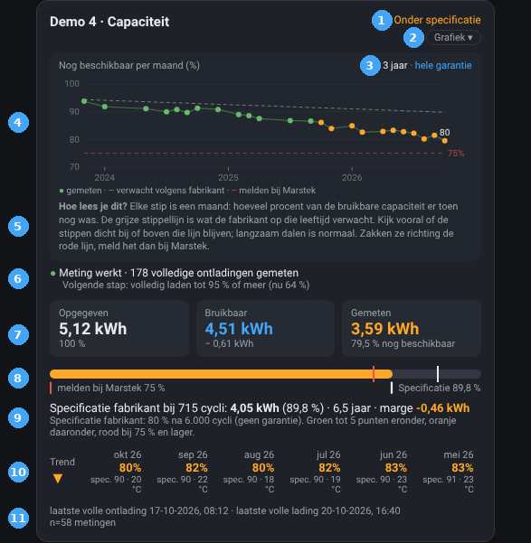

1. **Status**: *Goed*, *Onder specificatie*, *Melden bij Marstek (app)* of *Verzamelt data*. De kleur volgt de laatste meting.
2. **Werkt de meting?** Groen: de meting werkt en zoveel volledige ontladingen zijn gemeten. Blauw: nog data aan het verzamelen. Oranje of rood: geen nieuwe gegevens of een sensor ontbreekt. Tijdens het verzamelen of een volledige ontlading staat de volgende stap eronder; anders zie je die bij aanwijzen.
3. **Grafiek · SOC · Cellen**: *Grafiek* toont de grafiek op de plek van de capaciteiten (nog eens drukken = terug); de kaart blijft even hoog. *SOC* en *Cellen* openen een venster midden op het scherm; ✕ of klikken ernaast sluit het. Een ⚠ (let op) of 🔧 (advies) op *SOC* of *Cellen* betekent: kijk even. *Cellen* staat er alleen als de celspanningen zijn ingevuld.
4. **Instellingen** (tandwiel): brengt je naar deze batterij onder Instellingen → Apparaten en diensten; het tandwiel daar opent *Configureren*.
5. **Drie capaciteiten**: *Opgegeven* (op het typeplaatje), *Bruikbaar* (opgegeven min de reserve die de batterij zelf vasthoudt) en *Gemeten* (wat er nu echt uitkomt, en hoeveel procent van bruikbaar dat is).
6. **Balk**: de gemeten capaciteit, met een wit streepje voor de specificatie van de fabrikant en een rood streepje bij 75 %.
7. **Marge**: hoeveel je boven (+) of onder (−) de specificatie zit, met het aantal cycli en de leeftijd. Wijs aan voor de specificatie in kWh.
8. **Laatste volle ontlading en volle lading**, het aantal metingen en de versie van de kaart.

**De grafiek** toont de meest recente 3 jaar. Elke stip is een maand: hoeveel van de bruikbare capaciteit er toen nog was. ● gemeten, geijkt · ○ minder betrouwbaar (in de 14 dagen ervoor niet helemaal vol, of cellen kouder dan 5 °C) · grijze stippellijn: verwacht volgens specificatie · rode stippellijn: melden bij Marstek (75 %). Wijs een stip aan voor het getal, de specificatie en de celtemperatuur in die maand.

**SOC en Cellen** beantwoorden *Klopt mijn SOC-meter nog?* (per maand *Dagen helemaal vol* en *SOC-meter klopte*) en *Zijn mijn cellen nog in balans?* (celverschil per maand). Bij let op of advies staat in het venster wat je kunt doen en een knop **Wegklikken**. Zie [Hoe het werkt](03-how-it-works.nl.md#soc-drift-vanaf-05).

Heb je sensoren voor de hoogste en laagste celspanning gekoppeld, dan staat het **celverschil na volle lading** in het paneel **Cellen** (tot en met 0.4 onder de trend).

## Het overzicht

Het overzicht zet alle batterijen (tot 6) onder elkaar:

- **Batterij**: met ✓ (meting werkt), ⏳ (verzamelt data) of ⚠ (controleer de koppeling). Vanaf 0.5 ook ⚠ (let op) of 🔧 (advies) voor SOC-drift of celkalibratie; wijs hem aan om te zien welke, en open de kaart van die batterij.
- **Trend**: ▲ stijgend, ▬ gelijk, ▼ dalend over de getoonde maanden.
- **Nu**: de laatste meting.
- **Maanden**, van nieuw naar oud: groot getal = gemeten, klein getal = specificatie voor die maand.
- **Specificatie**: wat de fabrikant nu verwacht.

Groen: binnen 5 punten van de specificatie. Oranje: daaronder. Rood: 75 % of lager, melden via de Marstek-app.

## Galerij

De zes demobatterijen laten elk een andere situatie zien:

| Batterij | Situatie |
|---|---|
| Demo 1 | 4 jaar oud, goed; staat buiten, dus open stippen in de winter; SOC-meter 2× flink ernaast: ⚠ let op bij SOC |
| Demo 2 | 1,6 jaar oud, goed, met celverschil: 🔧 celkalibratie aanbevolen |
| Demo 3 | Net geïnstalleerd: verzamelt data voor de eerste meting |
| Demo 4 | 6,5 jaar oud, onder specificatie (oranje) |
| Demo 5 | 9 jaar oud, net onder 75 %: melden bij Marstek (rood), cellen in balans |
| Demo 6 | 2,8 jaar oud, goed, maar al even geen nieuwe gegevens (⚠) |

### 1 batterij

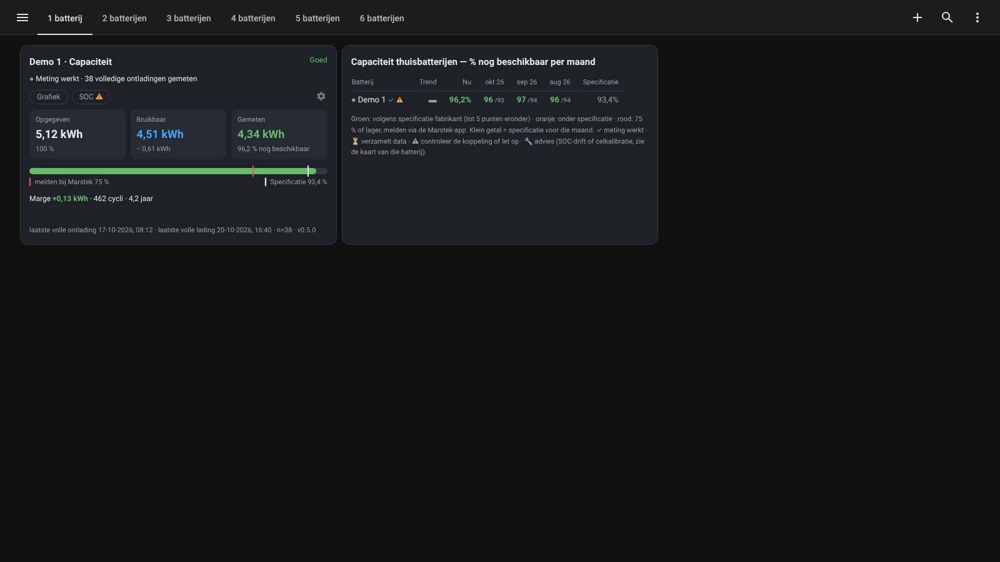
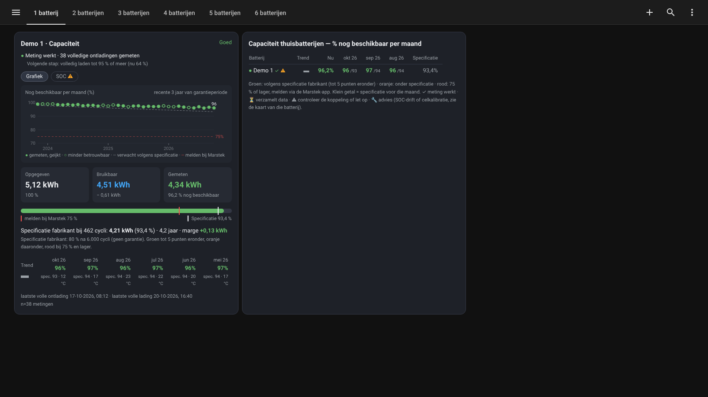

### 2 batterijen

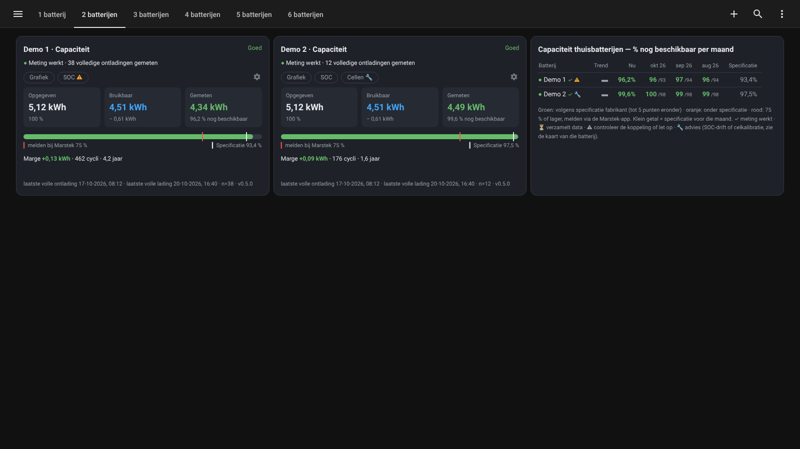
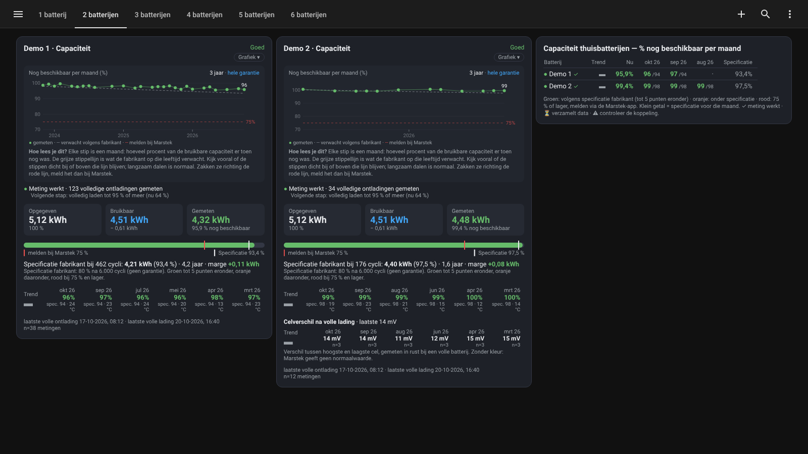

### 3 batterijen

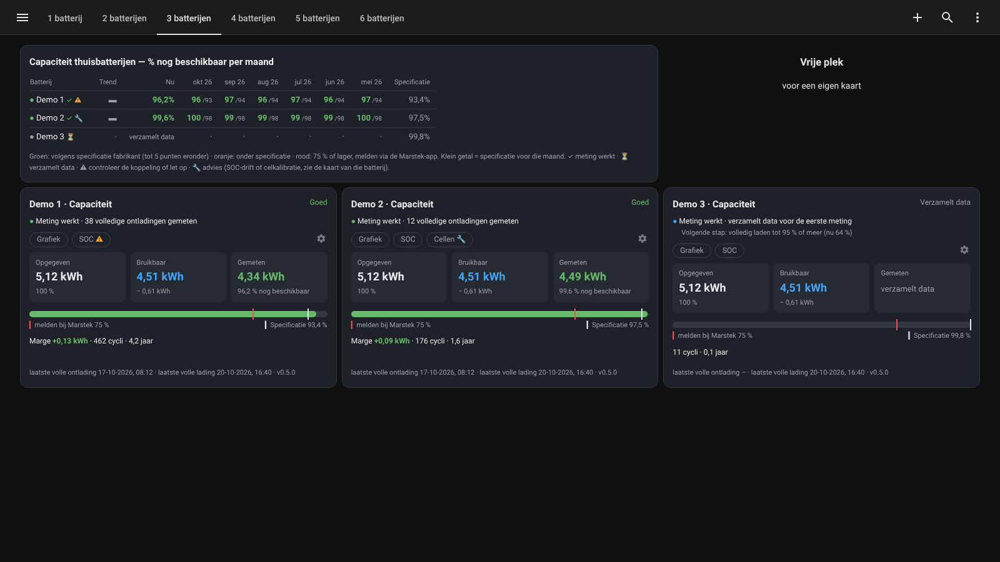
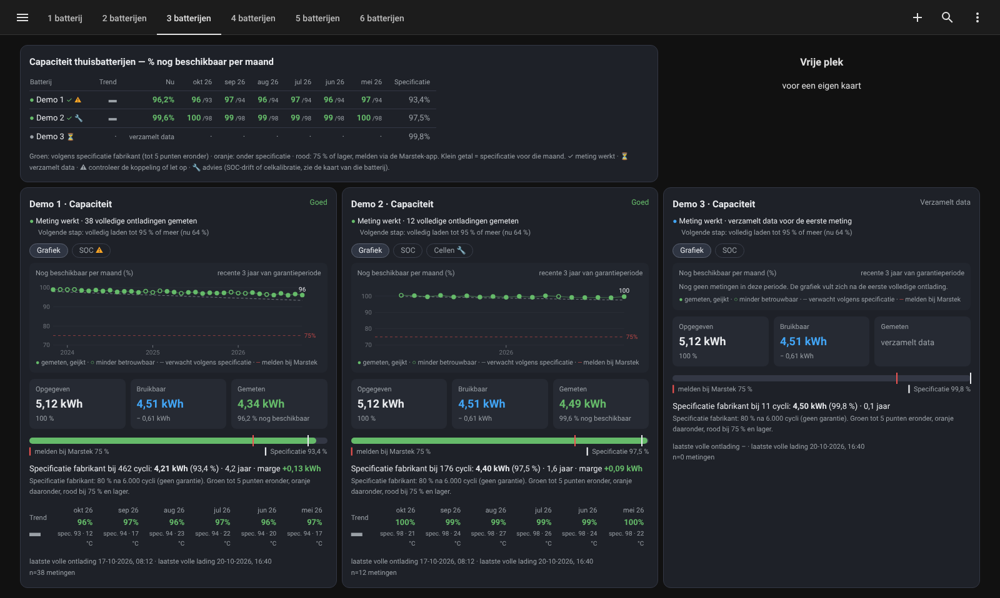

### 4 batterijen

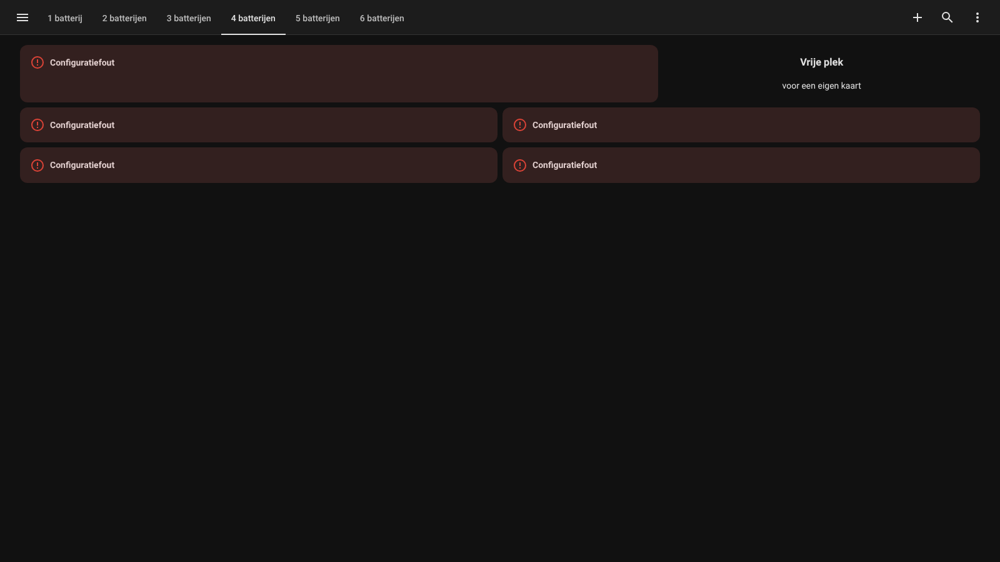

### 5 batterijen

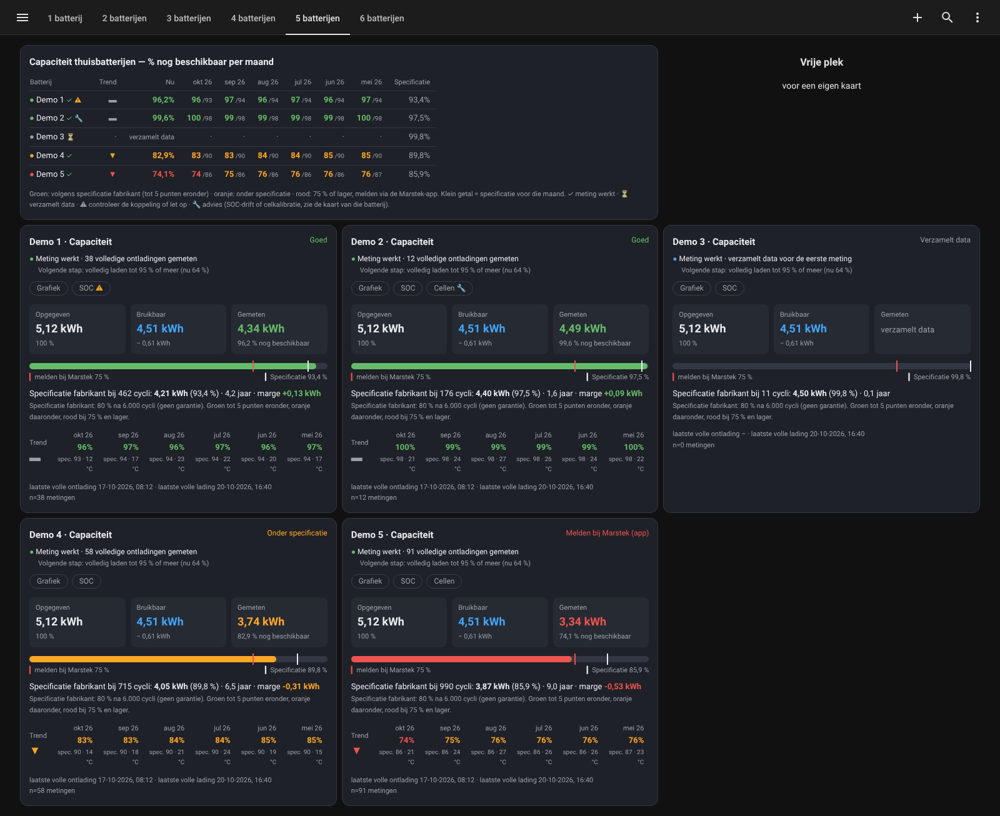
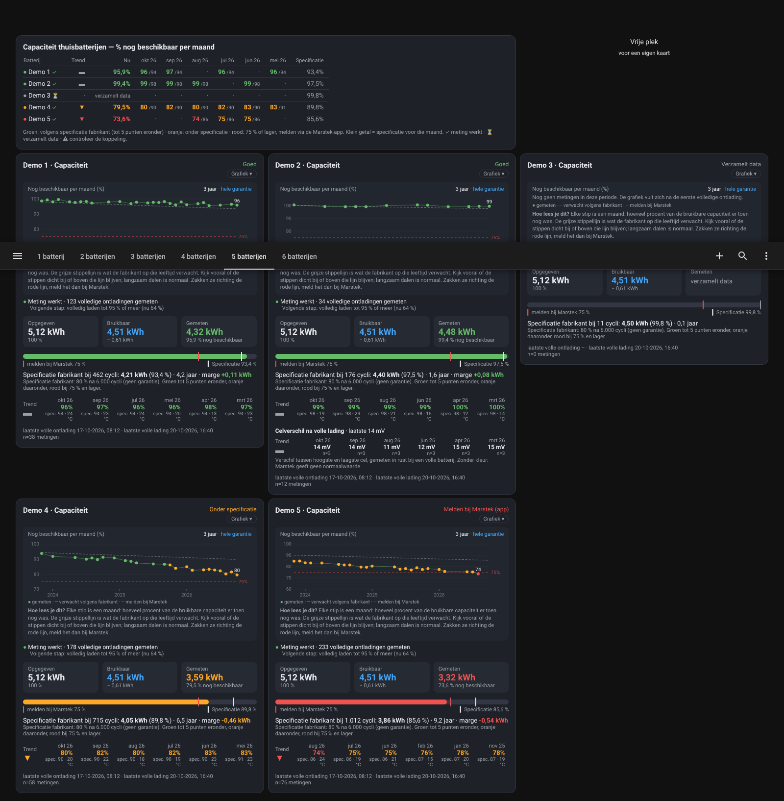

### 6 batterijen

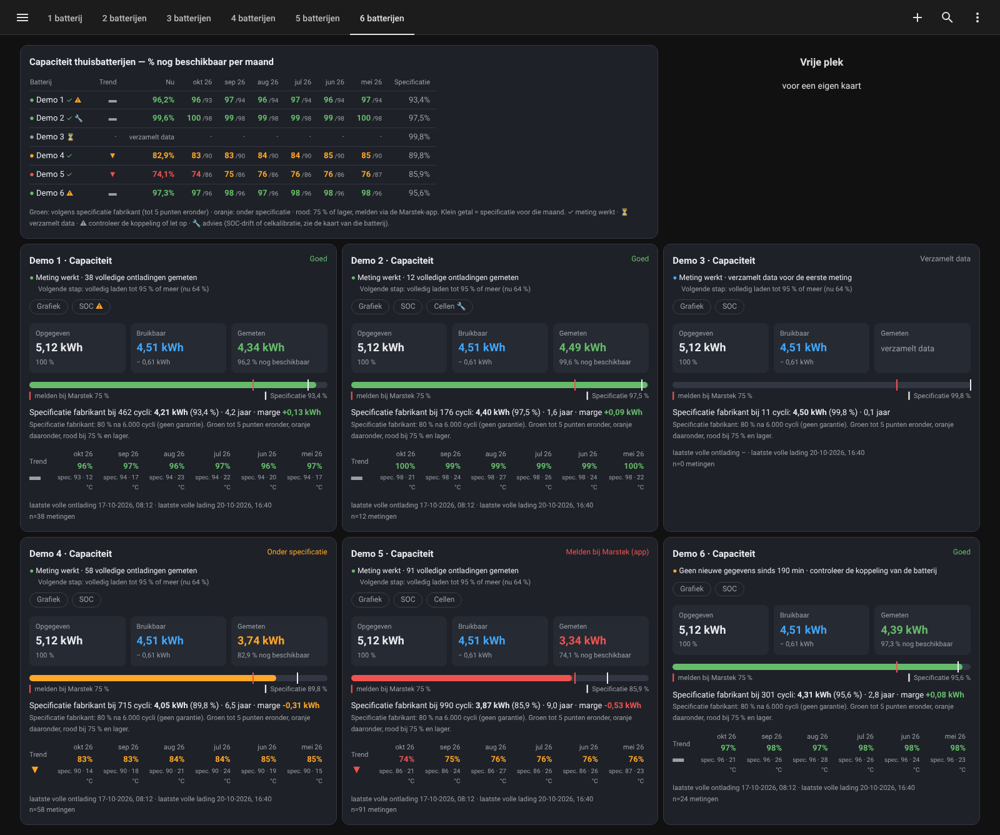
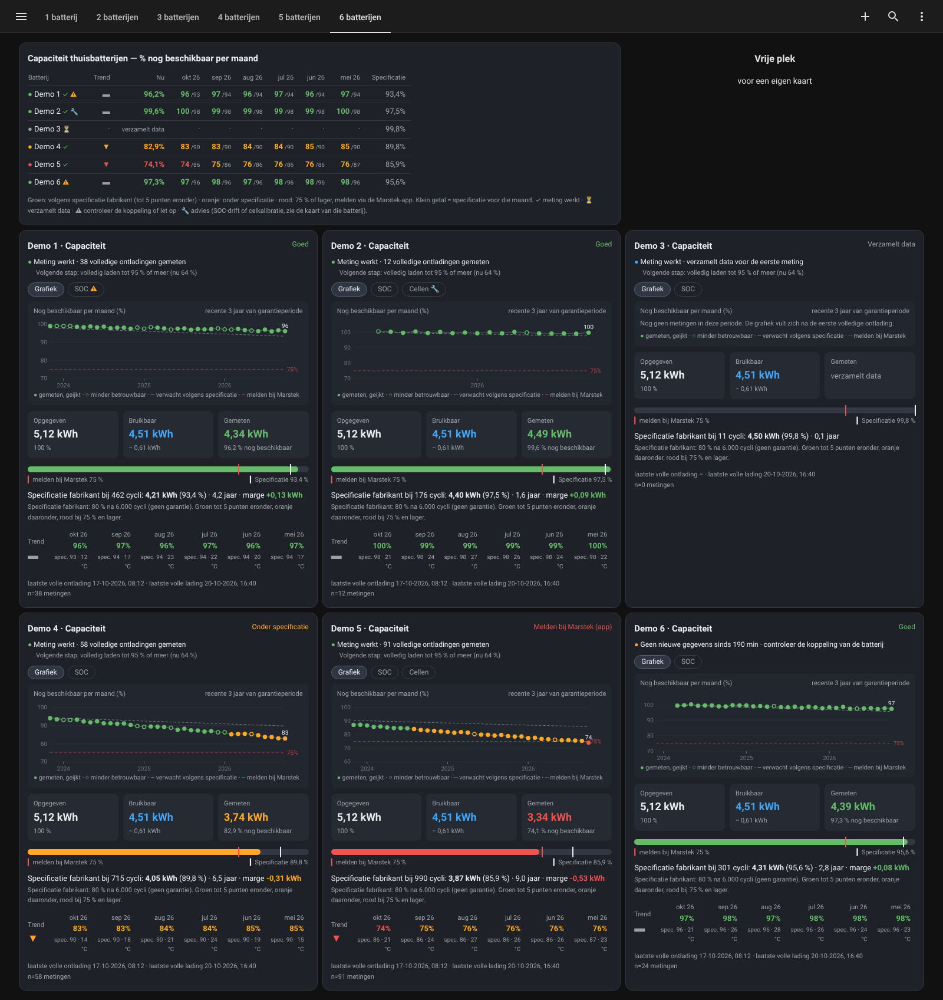

## Zelf een demo bekijken

De kaarten kennen nepgegevens via de optie `demo` (bij button-card: de variabele `demo`). De galerij hierboven is daarmee gemaakt. Die gegevens staan alleen in de dashboardinstellingen: er worden geen sensoren aangemaakt en er komt niets in je geschiedenis. Voor normaal gebruik heb je dit niet nodig.
